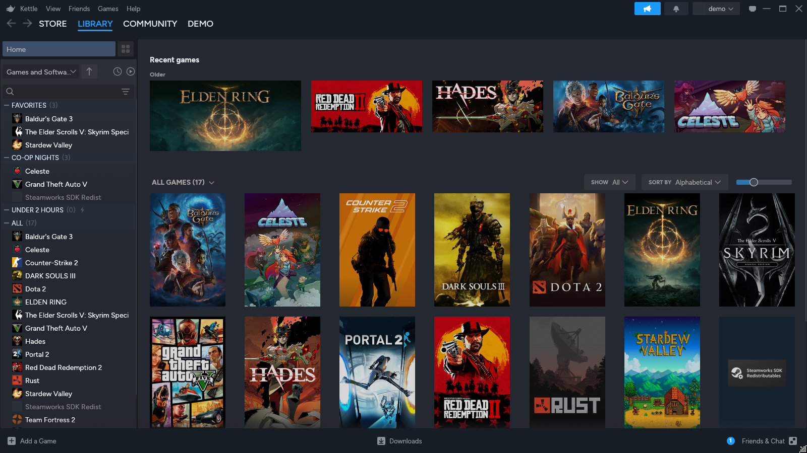
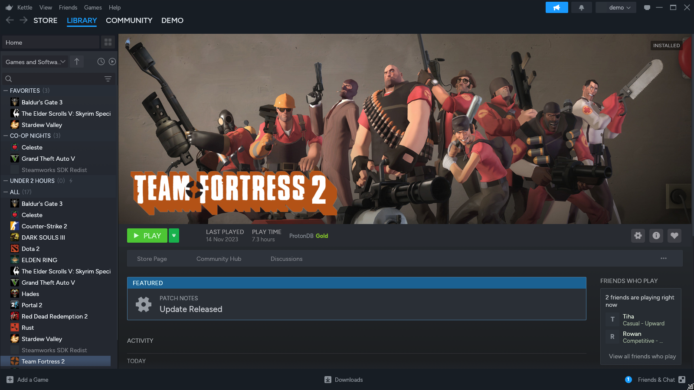
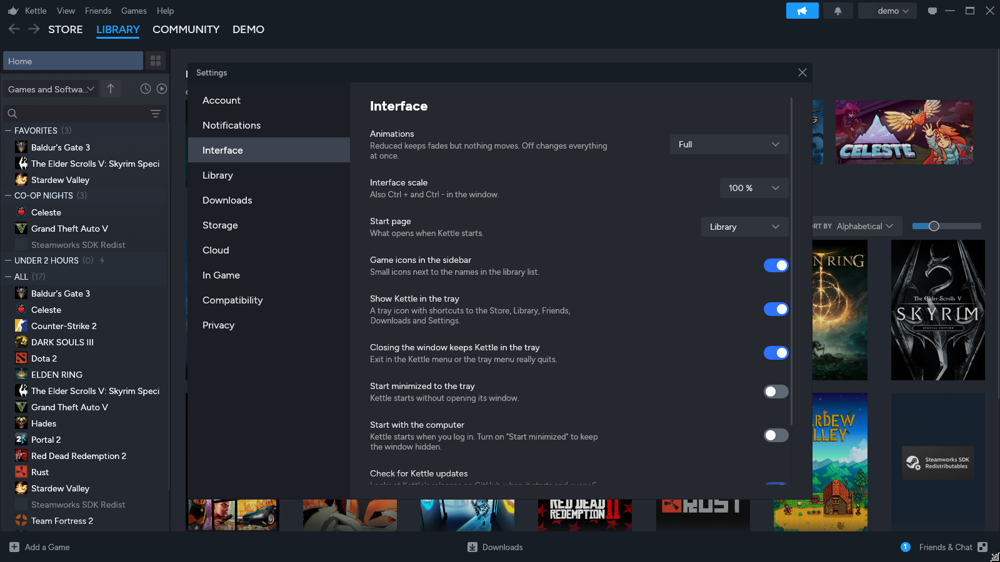
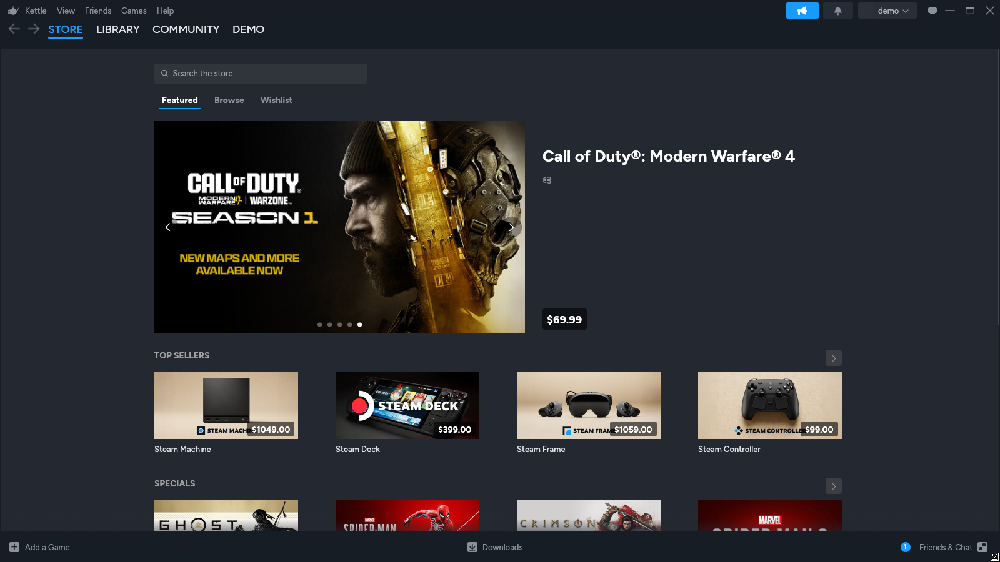

<p align="center"></p>

<h1 align="center">Kettle</h1>

<p align="center"><b>A fast, native Steam client for Linux. No Chromium, no web views.</b></p>

<p align="center">
<a href="https://github.com/SeniorMatt/kettle/releases/latest"></a>
</p>

<h3 align="center">
<a href="https://github.com/SeniorMatt/kettle/releases/latest">Download</a> &nbsp;·&nbsp;
<a href="#faq">FAQ</a> &nbsp;·&nbsp;
<a href="docs/roadmap.md">Roadmap</a> &nbsp;·&nbsp;
<a href="PRIVACY.md">Privacy</a>
</h3>

<a href="docs/images/screenshot-library.png"></a>

Kettle is a Steam client written in Rust (egui + wgpu). It starts quickly, stays light on memory, and works with the games you already have.

## Get started

1. Download `kettle-x86_64.AppImage` from the [latest release](https://github.com/SeniorMatt/kettle/releases/latest).
2. Make it executable: `chmod +x kettle-x86_64.AppImage`
3. Run it: `./kettle-x86_64.AppImage`, then scan the QR code with the Steam mobile app to sign in.

Kettle is in early development, so releases are marked as pre-releases.

## Screenshots

<a href="docs/images/screenshot-game.png"></a>

<a href="docs/images/screenshot-settings.png"></a>
<a href="docs/images/screenshot-store.png"></a>

The library above is a demo library, filled with well-known games.

## What you get

- **Sign in with a QR code.** Use the Steam mobile app. No password is typed or stored.
- **Your whole library**, with covers, search, collections, filters and game pages with news, achievements, DLC and friends who play.
- **Add any program** as a non-Steam game, or import the shortcuts you made in Steam.
- **Works with your existing Steam games.** Games installed by the official client are found automatically (Flatpak, Snap, `~/.local/share/Steam` and the Debian/Ubuntu package).
- **Downloads straight from Steam's servers.** Queue, pause, resume, verify, uninstall. Games go into Steam-format libraries, so the official client can use them too.
- **Play natively or with Proton.** Steam's Protons plus GE-Proton, Proton-CachyOS and more, chosen per game. Prefixes are shared with Steam, so saves are too.
- **Steam Cloud saves**: downloaded before a game starts, uploaded after it ends, and you choose when both sides changed.
- **The Store**, with your wishlist, reviews, trailers, browsing by tag and prices in your currency.
- **ProtonDB ratings** and per-game environment variables for Windows games.
- **Friends and chat**, and a Shift+Tab overlay with a performance HUD while a game started by Kettle is running.
- **Updates itself** (AppImage) when a new release is out, if you want it to.
- **No telemetry.** Kettle talks to Valve's servers, plus GitHub for its own updates and ProtonDB for ratings; nothing else. See [PRIVACY.md](PRIVACY.md).

## FAQ

**Is it safe?** Kettle never sees your password: you sign in by scanning a QR code with the official Steam mobile app. The login token is kept in your system keyring (GNOME Keyring, KWallet, KeePassXC). The code is open and nothing is sent anywhere but Valve, GitHub (update check) and ProtonDB (ratings). See [PRIVACY.md](PRIVACY.md). To end a session, remove the device in the Steam mobile app.

**Do I need Steam installed?** Not to sign in, browse, download or manage games. But some games use Steamworks features that Kettle does not fully replace yet, so for those Kettle starts an installed Steam client quietly in the background (`-silent`). Kettle also ships its own early Steamworks core, which is still in progress. If a game will not start, install Steam (the Flatpak works) and try again.

**Will it break my Steam setup?** No. Kettle uses Steam's own library format and shares compatdata, so both clients can use the same games.

**Windows or macOS?** Linux only for now.

## Progress

<!-- status:start -->
**Kettle does 46.2% of what Steam does** (78 of 169 features; see the [roadmap](docs/roadmap.md)).


| Area | Built |
|---|---|
| Account | 4/10 (40%) |
| Library | 16/24 (67%) |
| Store | 8/11 (73%) |
| Downloads | 10/18 (56%) |
| Play | 8/21 (38%) |
| Compatibility | 6/7 (86%) |
| Cloud | 3/4 (75%) |
| Friends | 3/9 (33%) |
| Chat | 1/8 (12%) |
| Overlay | 3/8 (38%) |
| Community | 0/15 (0%) |
| Notifications | 1/3 (33%) |
| Settings | 6/12 (50%) |
| Interface | 5/11 (45%) |
| Platform | 4/8 (50%) |
<!-- status:end -->

Kettle follows a public checklist of everything Steam does: the [roadmap](docs/roadmap.md).

## For developers

```
cargo build --release
target/release/kettle
```

`KETTLE_DEMO=2400 target/release/kettle` opens a demo library (no sign-in). Build the AppImage yourself with `scripts/build-appimage.sh` (writes `dist/kettle-x86_64.AppImage`; set `APPIMAGETOOL=/path` to use an existing appimagetool). `scripts/readme-screenshots.sh` retakes the screenshots above.

| Command | What it does |
|---|---|
| `sr-cli local` | Lists games installed by an existing Steam install |
| `sr-cli login` | Starts a QR login. The QR is written to `~/.cache/kettle/qr.svg` |
| `sr-cli owned <account>` | Counts the account's owned games |
| `sr-cli cm <account>` | Logs on to Steam's CM servers and shows the license count |
| `sr-cli logout <account>` | Removes the stored token |

See [ARCHITECTURE.md](ARCHITECTURE.md) for how the code is organized, [REFERENCES.md](REFERENCES.md) for the projects studied, and [TESTING.md](TESTING.md) for manual testing.

Game art is loaded at runtime from the local Steam cache or Steam's CDN and is never part of this repository. The UI uses the Figtree and Inter fonts (OFL-1.1) and Phosphor icons (MIT). If Motiva Sans is installed as a system font, Kettle uses it instead; it is never shipped.

## License

Dual-licensed under [MIT](LICENSE-MIT) or [Apache-2.0](LICENSE-APACHE), at your option.

> **Unofficial.** This project is not affiliated with, endorsed by, or sponsored by Valve Corporation. "Steam" is a trademark of Valve Corporation.
