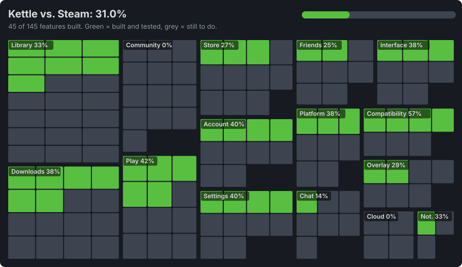

# Kettle

A fast, native Steam client written in Rust: egui + wgpu, with no Chromium and no web views.

> **Unofficial.** This project is not affiliated with, endorsed by, or sponsored by Valve Corporation. "Steam" is a trademark of Valve Corporation.

## Status

<!-- status:start -->
**Kettle does 35.1% of what Steam does** (52 of 148 features; see the [roadmap](docs/roadmap.md)).



| Area | Built |
|---|---|
| Account | 4/10 (40%) |
| Library | 11/24 (46%) |
| Store | 3/11 (27%) |
| Downloads | 6/16 (38%) |
| Play | 6/12 (50%) |
| Compatibility | 4/7 (57%) |
| Cloud | 0/4 (0%) |
| Friends | 2/8 (25%) |
| Chat | 1/7 (14%) |
| Overlay | 2/7 (29%) |
| Community | 0/13 (0%) |
| Notifications | 1/3 (33%) |
| Settings | 5/10 (50%) |
| Interface | 4/8 (50%) |
| Platform | 3/8 (38%) |
<!-- status:end -->

Early development. What works so far:

- QR-code login with the Steam mobile app. No password is ever entered or stored, and the refresh token is kept in the system keyring (Secret Service: GNOME Keyring, KWallet, KeePassXC).
- Owned games through the Steam Web API.
- Detecting games already installed by the official client: Debian/Ubuntu package, native `~/.local/share/Steam`, Flatpak and Snap layouts.
- A native desktop app (egui + wgpu): sign-in screen, library grid, sidebar with search, game pages, a Store tab, a custom title bar (Alt+drag moves the window, Ctrl+Tab switches tabs) and subtle animations.
- Downloads straight from Steam's content servers: a queue with pause, resume, verify and uninstall. Games go into Steam-format libraries, so the official client can use them too.
- Launching games ourselves: native, Proton or umu. Steam's compatdata prefixes are shared, so saves are too. Games that need the Steam client get the installed client started in the background (`-silent`).
- A compatibility tool manager: Steam's Protons plus GE-Proton, Proton-CachyOS, Proton-EM, Proton-Sarek and Luxtorpeda, with a per-game choice.
- Friends and chat, and a Shift+Tab in-game overlay while a game we started is running.
- Linux first. Windows builds from the same code (`scripts/build-windows.sh`).

Manual testing: see [TESTING.md](TESTING.md).

Privacy: no telemetry, only Valve's servers. See [PRIVACY.md](PRIVACY.md) for exactly what is stored and sent.

## Build

```
cargo build --release
target/release/kettle
```

`KETTLE_DEMO=2400 target/release/kettle` opens a demo library (no sign-in) for trying the UI.

Portable AppImage (one file, runs on any recent x86_64 Linux):

```
scripts/build-appimage.sh          # writes dist/kettle-x86_64.AppImage
```

The script downloads `appimagetool` on first use; set `APPIMAGETOOL=/path/to/appimagetool` to use one you already have.

Developer CLI:

| Command | What it does |
|---|---|
| `sr-cli local` | Lists games installed by an existing Steam install |
| `sr-cli login` | Starts a QR login. The QR is written to `~/.cache/kettle/qr.svg` |
| `sr-cli owned <account>` | Counts the account's owned games |
| `sr-cli cm <account>` | Logs on to Steam's CM servers and shows the license count |
| `sr-cli logout <account>` | Removes the stored token (remove the device in the Steam Mobile App to end the session on Steam's side) |

## Design

See [ARCHITECTURE.md](ARCHITECTURE.md) for how the code is organized, and [REFERENCES.md](REFERENCES.md) for the projects studied.

Game art is loaded at runtime from the local Steam cache or Steam's CDN, and is never part of this repository. The UI uses the Figtree and Inter fonts (OFL-1.1) and Phosphor icons (MIT).

## License

Dual-licensed under [MIT](LICENSE-MIT) or [Apache-2.0](LICENSE-APACHE), at your option.
